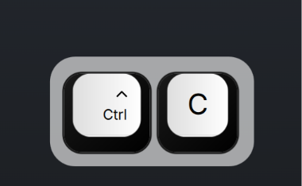
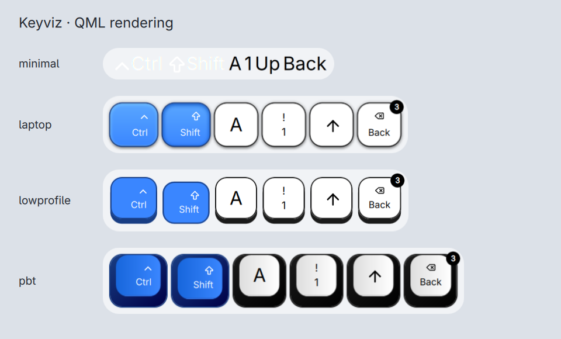

# Keystrokes

**A keystroke and mouse-action overlay for [DankMaterialShell](https://github.com/AvengeMedia/DankMaterialShell)** — draws your keypresses and mouse actions in real time while you record a screencast or stream a presentation.

<p align="center">
  
</p>

## Overview

Keystrokes brings high-fidelity keystroke visualization to the DankMaterialShell / Quickshell environment. Ported 1:1 from [mulaRahul/keyviz](https://github.com/mulaRahul/keyviz), it features pixel-perfect keycap geometries, smooth entrance/exit animations, hotkey combination detection, and real-time press repeat counters.

## Features

- **Combinations and Chords**: `Ctrl + Shift + S` groups into a single row; consecutive single keys flow naturally.
- **Four Keycap Skins**: Minimal, Laptop, Low Profile (default), and PBT ported with exact Keyviz vector geometries.
- **Real Press Feedback**: Real-time press badges counting repeats as you hold or hammer a key (`Ctrl×5 + C×1`).
- **Five Animation Types**: `none`, `fade`, `zoom`, `float`, and `slide` with independent durations and easing curves.
- **Flexible Positioning**: 9 screen anchor positions on any output with automatic multi-monitor follow-focus support.
- **Intelligent Filtering**: Show all keys, hotkeys only (requiring leading modifier), or your own custom whitelist.
- **Mouse & Audio Feedback**: Mouse clicks, drags, and wheel events rendered as keycaps, plus mute status sync.
- **Rich Palettes & Presets**: 14 upstream color presets, style randomization, and export/import via JSON.

## Keycap Styles

<p align="center">
  
</p>

All four styles are direct ports of keyviz's keycap components. Switching between styles preserves your custom color configuration consistently.

## Requirements

- **Linux** (Wayland recommended: Hyprland, Niri, Sway; or X11)
- **[Quickshell](https://github.com/outfoxxed/quickshell)** (0.0.9+) & **[DankMaterialShell](https://github.com/AvengeMedia/DankMaterialShell)** (1.5.0+)
- **`libinput`** CLI installed (`evtest` available as fallback)
- User must belong to the **`input`** group (`/dev/input/event*` access)

## Installation

Clone this repository into your DMS plugins directory:

```bash
git clone https://github.com/Tz-slayer/keystrokes.git \
  ~/.config/DankMaterialShell/plugins/keystrokes
```

Ensure your user is part of the `input` group and `libinput` is installed:

```bash
sudo usermod -aG input $USER     # Log out and log back in to take effect
sudo pacman -S libinput          # Arch Linux (or apt install libinput-tools on Ubuntu/Debian)
```

Then enable **Keystrokes** in the DMS Control Center plugin settings.

## Quick Start

- **Toggle Overlay**: Press `Shift + F10` (default toggle shortcut), or toggle via the DMS Control Center widget.
- **Via IPC**:
  ```bash
  dms ipc keystrokes toggle       # Toggle overlay on/off
  dms ipc keystrokes test         # Play demo animation sequence
  dms ipc keystrokes setStyle pbt # Switch keycap skin
  ```

## Configuration

All configuration is accessible from the plugin settings page in the DMS Control Center:

- **Filtering & History**: Show all keys, hotkeys only, or custom whitelist; configure history mode and row count.
- **Display & Margins**: Choose output display (Follow focused output or pinned monitor), and customize X/Y margins.
- **Colors & Borders**: Modifier colors, normal colors, gradients, fractional border widths, and corner radii.
- **Keycap Content**: Keycap labels, capitalization, icons, and special symbols.

## Documentation

Comprehensive project documentation is maintained under [`docs/`](docs/):

- **[Architecture](docs/ARCHITECTURE.md)**: System design, static component topology, layering rules, and data structures.
- **[Runtime & Business Flows](docs/FLOWS.md)**: Input pipeline, state machines, hotkey arbitration, lifecycle, and invariants.
- **[Development Guide](docs/DEVELOPMENT.md)**: Setup, build/run, tracing, automated testing matrix, and troubleshooting.
- **[Agent Instructions](AGENTS.md)**: Coding rules, architecture boundaries, and checklists for AI Coding Agents.
- **[Changelog](CHANGELOG.md)**: Historical version changes and release logs.

## Credits

- **[mulaRahul/keyviz](https://github.com/mulaRahul/keyviz)** (MIT) — Original visual designs and core event logic.
- **[loccun/dms-screenkey](https://github.com/loccun/dms-screenkey)** (MIT) — Input stream reading concepts for DMS.

## License

MIT — see [LICENSE](LICENSE).