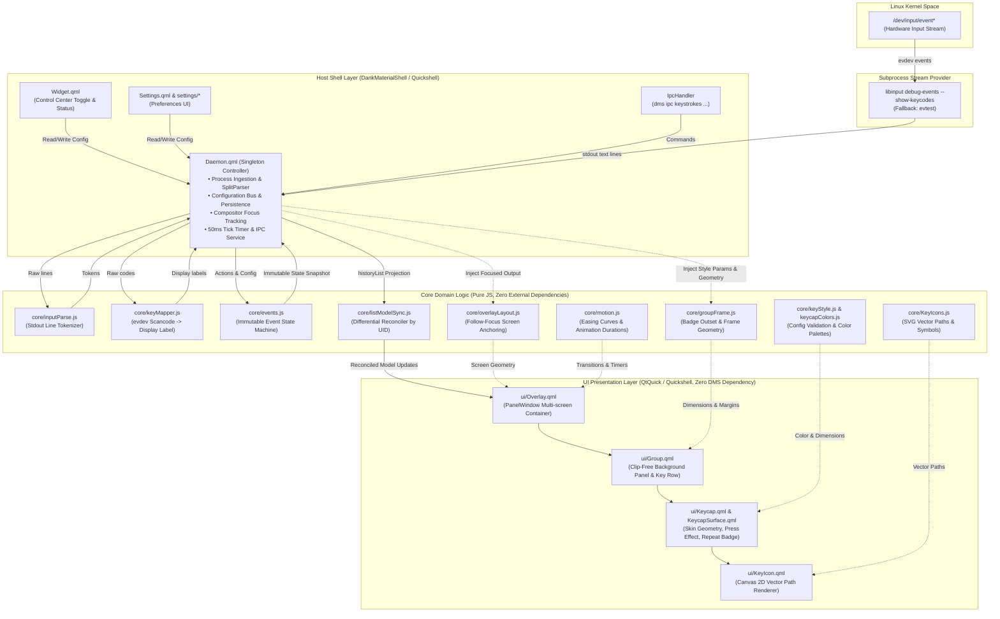

# Architecture

## 1. Overview

Keystrokes 是专为 [DankMaterialShell](https://github.com/AvengeMedia/DankMaterialShell) (DMS) 与 [Quickshell](https://github.com/outfoxxed/quickshell) 桌面环境打造的高性能屏幕按键与鼠标操作回显插件（Screencast Overlay）。

项目以 [mulaRahul/keyviz](https://github.com/mulaRahul/keyviz) 为参考基准，采用 1:1 像素级几何还原与纯函数式状态机，为录屏、演示与教学场景提供流畅、直观的按键可视化。

### 核心定位与技术指标
- **精准的组合键与连击识别**：支持多键和弦（Chords）、修饰键先行判定、单键连击计数（Press-count badge）。
- **四款高保真键帽皮肤**：Minimal、Laptop、Low Profile（默认）、PBT，矢量绘制与阴影完全对齐 keyviz。
- **纯函数不可变领域模型**：核心状态机与几何计算完全无外部依赖，零全局可变状态，保证高频事件下的绝对稳定。
- **宿主环境解耦**：核心逻辑层（`core/`）与视图呈现层（`ui/`）对 DMS 保持零依赖，支持跨平台无头测试（Headless Test）。

---

## 2. System Architecture

<p align="center">
  
</p>

<details>
<summary><b>展开查看 Mermaid 源码</b></summary>



</details>


---

## 3. Project Structure

```text
keystrokes/
├── Daemon.qml             # 常驻守护进程：子进程拉起、数据编排、IPC 服务、定时器管理
├── Widget.qml             # DMS 控制中心托盘小组件：开关指示、快捷控制、设备切换
├── Settings.qml           # 设置界面顶层入口（调用 settings/ 目录组件）
├── plugin.json            # DMS 插件清单元数据
├── package.json           # 项目元数据与测试脚本命令
├── README.md              # 项目主入口说明书
├── AGENTS.md              # Coding Agent 行为规范与设计约束
├── CHANGELOG.md           # 版本更新履历
│
├── core/                  # [核心领域层] 纯 JavaScript 模块（零外部依赖、零全局状态）
│   ├── events.js          # 不可变按键状态机：成组、连击递增、暂定裁决、过期移除
│   ├── inputParse.js      # libinput 与 evtest 终端行解析分词器
│   ├── keyMapper.js       # Linux evdev scancode 到显示标签的标准映射表
│   ├── KeyIcons.js        # 键帽矢量图标库（SVG 路径数据）与短标签转换
│   ├── keyStyle.js        # 配置模式校验、默认值合同、版本迁移与色彩预设
│   ├── keycapColors.js    # 颜色模型换算与感知亮度调整（WCAG 对比度）
│   ├── groupFrame.js      # 物理面板几何计算（徽章外挑、阴影与圆角外扩计算）
│   ├── overlayLayout.js   # 屏幕多显示器焦点定位、锚点坐标与边距计算
│   ├── motion.js          # 入场/退场缓动曲线 (Cubic Bezier) 与动画节奏
│   └── listModelSync.js   # QML ListModel 差异调和算法（按持久 UID 复用）
│
├── ui/                    # [视图呈现层] 纯界面组件（依赖 QtQuick/Quickshell，零 DMS 依赖）
│   ├── Overlay.qml        # 顶层浮层窗口容器（PanelWindow 附着、多行排版）
│   ├── Group.qml          # 按键行容器（无裁剪外扩背景、按键水平流排布）
│   ├── Keycap.qml         # 键帽复合组件（皮肤切换、按压动效、连击角标）
│   ├── KeycapSurface.qml  # 键帽背景微表面 Canvas 绘制（边框高光、微阴影）
│   └── KeyIcon.qml        # 键帽内嵌矢量图标 Canvas 渲染
│
├── settings/              # [设置组件层] DMS 设置面板分组行组件
│   ├── ParitySettings.qml # 设置项全量行排版
│   ├── SettingRow.qml     # 统一设置行封装外壳（防 QtQuick.Row 命名冲突）
│   ├── ColorRow.qml       # 调色盘配置行
│   ├── ColorSwatch.qml    # 独立色块选择器
│   └── ValueSetting.qml   # 数值与滑块调节封装
│
├── dms/                   # [第三方契约] DankMaterialShell 控件 vendored 副本
│   └── widgets/           # 上游 UI 基础控件
│
├── tests/                 # [自动化测试体系]
│   ├── helpers/           # 测试沙箱与 Mock 环境 (QtQuick VM 仿真)
│   ├── *.test.cjs         # 领域逻辑、布局算法与架构规则自动化测试
│   └── docs-links.cjs     # 文档全量死链与资源引用守卫
│
└── docs/                  # [项目文档中心]
    ├── ARCHITECTURE.md    # 静态系统架构、组件结构与设计规范
    ├── FLOWS.md           # 动态运行流程、状态机模型与系统不变量
    ├── DEVELOPMENT.md     # 开发环境配置、调试机制、测试与排障指南
    ├── cover.png          # 项目封面与架构插图
    └── keycap-preview.png # 四大皮肤视觉效果参考图
```

---

## 4. Core Components

### 4.1 Shell Host Layer (DMS / Quickshell 集成层)
- **`Daemon.qml`**
  插件的运行时大脑。作为单例运行于 DMS 守护进程空间中，负责：
  1. 拉起并监控 `libinput debug-events` 或 `evtest` 后台子进程；
  2. 将原始输出行切分为输入流并送入解析管道；
  3. 维护 `keyboardState`，并将状态快照投射为 `historyList`；
  4. 对接 `CompositorService` 获取焦点屏幕，将布局上下文注入 `Overlay.qml`；
  5. 注册 Quickshell `IpcHandler`，对外暴露 `dms ipc keystrokes ...` 指令接口。
- **`Widget.qml`**
  DMS 控制中心状态小组件，提供插件启用/禁用开关、快速切换输入设备、显示当前设备捕获状态。严禁直接触碰内部状态机，只通过读写配置或调用 `Daemon` 暴露的接口通信。
- **`Settings.qml` & `settings/*`**
  插件配置面板。采用数据驱动机制渲染 70+ 个配置属性。针对 `Daemon` 离线状态具备降级保底能力。

### 4.2 Core Domain Layer (核心领域逻辑层)
所有模块均置于 `core/` 下，为**纯函数无状态模块**：
- **`events.js`**：核心事件状态机。接收 `(state, label, now, config)`，产出全新的不可变 `state`。完全掌控门禁过滤、多键和弦、修饰键暂定延期、连击递增、超时消逝。
- **`inputParse.js`**：文本分词器。解析 Linux libinput 事件流与 evtest 事件流，剔除内核级 autorepeat 冗余帧。
- **`keyMapper.js`**：键码字典。将硬件层 `KEY_LEFTCTRL`、`KEY_COMPOSE`、`BTN_LEFT` 转换为人类可读的统一显示标签（如 `Ctrl`、`Menu`、`Click`）。
- **`KeyIcons.js`**：图标路径库。内置 40+ 个按键矢量符号（SVG Path），如退格、回车、方向键、音量控制。
- **`keyStyle.js`**：配置规整器。执行存量配置键迁移、取值范围校验（Clamp/Fallback）以及 14 套上游预设主题的管理。
- **`groupFrame.js`**：几何模型引擎。计算面板外包络矩形，精确外扩以容纳 0.75em 计数角标和投影边框，彻底杜绝硬裁剪。
- **`overlayLayout.js`**：屏幕布局引擎。解析 9 宫格对齐位置（如 `bottom_center`）、内外边距、多输出屏幕（`@focused` / `@primary`）坐标定位。
- **`motion.js`**：动效语义化。定义入场、退场的三次贝塞尔曲线以及重排位移时间常数（`animationDuration / 3`）。
- **`listModelSync.js`**：增量调和器。对比当前 ListModel 与新状态投影，原地更新存活项，追加新项，为离场项标记 `dying: true`。

### 4.3 UI Presentation Layer (渲染展现层)
- **`Overlay.qml`**：顶层透明浮层窗口，使用 Quickshell `PanelWindow` 实现，动态挂载于指定物理显示器。
- **`Group.qml`**：单行按键分组容器。由背景圆角矩形与水平 `Row` 构成（背景与内容为平级兄弟节点，绝不使用 `clip: true`）。
- **`Keycap.qml`**：独立键帽渲染载体。承载 4 种皮肤几何分支、按键按下挤压动效、右上角连击数字角标（`press-count`）。
- **`KeycapSurface.qml`**：键帽质感微表面，利用 HTML5 Canvas 规范在 QML Canvas 上绘制亚像素渐变和投影边框。
- **`KeyIcon.qml`**：使用 2D Canvas 实时绘制 `KeyIcons.js` 提供的矢量路径。

### 4.4 Storage & Configuration Layer (持久化与配置层)
- 基于 DMS `PluginService` 的 `pluginData` 键值持久化机制。
- 采用单一配置源原则（Single Source of Truth），所有默认值在 `core/keyStyle.js`、`Daemon.qml` 与 `Settings.qml` 之间严格保持一致。

---

## 5. Module Dependencies & Layering Boundaries

### 依赖关系拓扑

```text
┌────────────────────────────────────────────────────────┐
│                      DMS 宿主环境                       │
│    qs.Common / qs.Services / qs.Widgets / Theme        │
└──────────────────────────┬─────────────────────────────┘
                           │ 允许且仅允许入口层依赖
                           ▼
┌────────────────────────────────────────────────────────┐
│                   Entry Points & UI                    │
│    Daemon.qml   Widget.qml   Settings.qml   settings/* │
└────────────────────┬───────────────────────────────────┘
                     │ 调用与注入数据
                     ▼
┌───────────────────────────────────┐    ┌───────────────────────────────────┐
│     UI Presentation Layer         │    │       Core Domain Logic           │
│             ui/*.qml              ├───►│            core/*.js              │
│ (只依赖 QtQuick / Quickshell)      │    │ (纯函数，零外部依赖，零全局状态)     │
└───────────────────────────────────┘    └───────────────────────────────────┘
```

### 架构边界硬性准则

| 边界规则 | 违反后果 | 自动化测试守卫 |
| --- | --- | --- |
| `core/` 严禁 `import` 任何模块（包括 QML 或外部 JS） | 破坏纯函数隔离，导致无法无头测试 | `tests/layering.test.cjs` |
| `core/` 与 `ui/` 严禁引用 DMS 符号（`qs.*` / `Theme` / `PluginService` / `Dank*`） | 导致渲染层与特定桌面环境锁死 | `tests/layering.test.cjs` |
| `ui/` 严禁反向引用 `Settings.qml`、`Widget.qml` 或 `settings/*` | 导致展示层与配置界面循环依赖 | `tests/layering.test.cjs` |
| QML 文件名绝不遮蔽 QtQuick 内置控件名（如严禁使用 `Row.qml`） | 隐式导入优先机制导致组件编译崩溃、整页空白 | `tests/module-imports.test.cjs` |
| `Daemon.qml` 默认值与 `Settings.qml` `defaultValue` 必须完全相等 | 未修改设置的用户出现“看到的值与生效的值不符” | `tests/defaults-consistency.test.cjs` |

---

## 6. Data Model

### 6.1 核心状态模型 (`KeyboardState`)
`core/events.js` 维护的状态快照数据结构：

```typescript
interface KeyboardState {
    // 当前处于物理按下状态的显示标签集合（包含被门禁拒绝的按键）
    heldKeys: string[];

    // 真正放行上屏的物理按住键集合（用于驱动键帽按下动效）
    shownKeys: string[];

    // 屏幕上显示的所有按键行列表
    groups: GroupEntry[];

    // 全局单调自增 UID 发号器（确保每个视觉组拥有唯一身份）
    nextUid: number;

    // 是否处于“等待下一个按键裁决是否为历史重按”的悬挂状态
    pendingRepeat: boolean;

    // 暂定孤立修饰键裁决状态（区分是第 N 次单按，还是组合键先行键）
    pending: PendingModifier | null;
}

interface GroupEntry {
    uid: number;               // 稳定行标识符（调和算法 keyField）
    keys: KeyEntry[];          // 该行包含的所有键帽
}

interface KeyEntry {
    label: string;             // 显示标签（如 "Ctrl", "C"）
    count: number;             // 该按键的连击计数（>= 1，单调递增）
    lastPressedAt: number;     // 最近一次按下的时间戳 (Date.now())
    animateIn: boolean;        // 是否播放初次入场位移动画
}

interface PendingModifier {
    key: string;               // 暂定修饰键标签（如 "Ctrl"）
    count: number;             // 当前已确认的连击计数
    rowUid: number;            // 暂定行所占用的 UID
}
```

### 6.2 视图模型投影 (`HistoryList`)
由 `Daemon.qml` 经 `applyKeyboard` 派生并供给 QML ListModel 渲染的扁平对象：

```typescript
interface HistoryRowProjection {
    uid: number;               // 对应 GroupEntry.uid
    keys: {
        keyId: string;         // 键唯一标识（即 label）
        label: string;         // 视觉标签
        text: string;          // 显示字符串
        count: number;         // 连击计数
        lastPressedAt: number; // 时间戳
        animateIn: boolean;    // 入场动效开关
        dying?: boolean;       // 退场中标记
    }[];
}
```

---

## 7. External Interfaces

### 7.1 Linux Input 子系统与外部工具
- 宿主依赖：要求当前用户在 `input` 用户组中，具有访问 `/dev/input/event*` 的权限。
- 输入流主管道：通过 `Quickshell.Io.Process` 执行命令：
  ```sh
  libinput debug-events --show-keycodes [--device /dev/input/eventX]
  ```
- 降级流备选：无 libinput 环境时回退至 `evtest /dev/input/eventX`。

### 7.2 Quickshell IPC 接口
通过 `IpcHandler { target: "keystrokes" }` 注册，支持 DMS 终端与脚本调用：

| IPC 指令 | 参数签名 | 语义说明 |
| --- | --- | --- |
| `toggle` | `(): string` | 切换插件启用状态（开/关） |
| `enable` | `(): string` | 启用插件并拉起输入流 |
| `disable` | `(): string` | 禁用插件并终止输入流 |
| `setStyle` | `(id: string): string` | 切换皮肤 (`minimal` / `laptop` / `lowprofile` / `pbt`) |
| `test` | `(): string` | 播放按键动画预览样本（无需物理按键输入） |
| `exportStyle`| `(): string` | 导出当前样式配置为标准 JSON 字符串 |
| `importStyle`| `(json: string): string` | 导入并校验外部样式 JSON 配置 |
| `trace` | `(seconds: string): string` | 启动 `N` 秒的输入流与状态机同步遥测采样；`0` 则停止并返回追踪日志 |

> [!IMPORTANT]
> **IPC 强类型约束**：`IpcHandler` 中定义的所有函数参数必须显式声明类型（例如 `seconds: string`）。若省略类型，Qt 将其推断为 `QVariant`，导致 IPC 运行时静默拒绝注册该命令。

### 7.3 Compositor 交互
通过 `qs.Services.CompositorService` 与 `NiriService` 获取当前活跃的 Wayland 输出名称（Output Name）。由 `Daemon.qml` 统一查询后注入 `Overlay.qml`，渲染层自身不直接请求合成器。

---

## 8. Runtime Architecture

```text
  ┌─────────────────────────────────────────────────────────────┐
  │                        Event Loop                           │
  │                                                             │
  │  [Subprocess I/O]          [50ms Tick Timer]   [UI Timers]  │
  │  libinput stdout lines     Active only when    Exit/Fade    │
  │  (Event-driven push)       groups.length > 0   (Per-item)   │
  └───────────────┬────────────────────┬────────────────┬───────┘
                  │                    │                │
                  ▼                    ▼                ▼
         Input Parsing Pipeline   Events.tick()   Exit Animation
                  │                    │                │
                  └──────────────┬─────┴────────────────┘
                                 │
                                 ▼
                     applyKeyboard Snapshot
                                 │
                                 ▼
                   listModelSync.reconcile()
                                 │
                                 ▼
                   QtQuick Scene Graph Render
```

- **事件驱动与零轮询空转**：输入子进程基于 stdout 行中断驱动，按键到来时即时响应。
- **按需激活的 Tick 定时器**：负责超时淡出的 50ms 定时器仅在屏幕上有活跃键帽时运行（`running: groups.length > 0`），空闲时完全休眠，CPU 占用为 0%。
- **不可变状态快速比较**：`core/events.js` 遵循纯函数语义。当 `tick` 未发生任何数据变化时，直接返回输入状态的原对象引用。调用方通过对象同一性判断（`state === oldState`）跳过后续的 ListModel 同步开销。

---

## 9. Design Principles

1. **纯函数不可变内核 (Immutable Functional Core)**
   状态转换 `f(state, event) -> newState` 保证无副作用。每次动作生成全量快照，杜绝状态局部撕裂与竞态条件。
2. **单一身份权威：显示标签 (Display Label as Single Source of Truth)**
   键的内部标识统一使用人类可读的显示标签（如 `Ctrl` 而非 `KEY_LEFTCTRL`）。无论是键盘、鼠标按键、滚轮还是 IPC 模拟信号，进入状态机前均完成归一化，杜绝双重键帽 Bug。
3. **几何外扩代替硬裁剪 (Frame Expansion over Clipping)**
   为了展示 0.75em 计数角标和亚像素阴影，分组底板严格禁止 QML `clip: true`，而是由 `core/groupFrame.js` 统一计算包含阴影、角标与圆角安全内缩的边界，从物理几何上包容全部外挑渲染。
4. **单向数据流与单一设置键 (Unidirectional Data Flow & Unique Keys)**
   每个业务逻辑有且仅有一个配置键。开关、设置面板与后台数据统一绑定，杜绝“状态开着但设置页显示关着”的双源冲突。
5. **增量调和保证委托复用 (Differential Reconciliation by UID)**
   ListModel 调和算法严格基于唯一单调自增 UID。存活项原地属性覆盖，避免组件反复创建引发的闪烁与重绘。

---

## 10. Technical Constraints

1. **Linux `/dev/input` 权限**：普通用户必须加入 `input` 组并重新登录，否则守护进程无法捕获任何内核按键。
2. **QML 类型命名冲突保护**：QML 目录隐式导入优先级高于模块导入，因此项目内 QML 严禁与 QtQuick 基础控件重名（如严禁使用 `Row.qml`，必须使用 `SettingRow.qml`）。
3. **IPC 参数强类型签名**：所有 IPC 槽函数入参必须有显式类型声明。
4. **Quickshell JSC 编译缓存**：开发调试时需警惕 `~/.cache/quickshell/qmlcache/` 的缓存机制，必要时需核对 `buildStamp` 确认代码生效。
