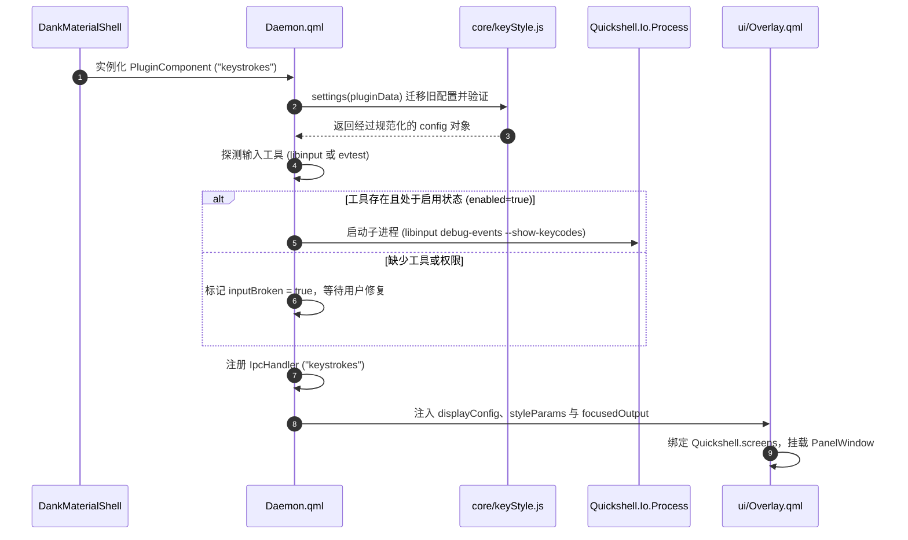
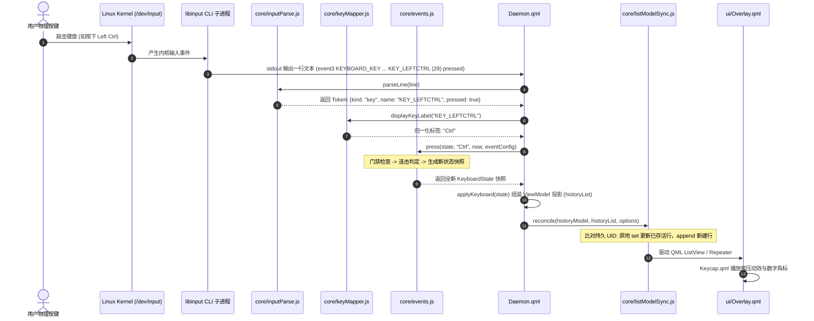
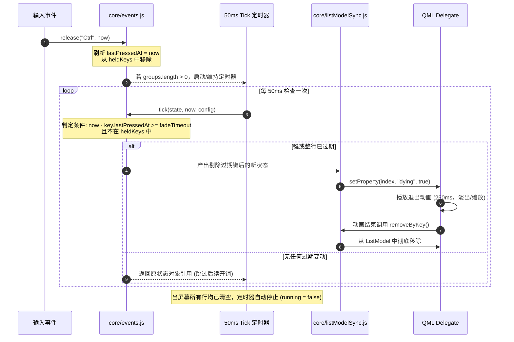
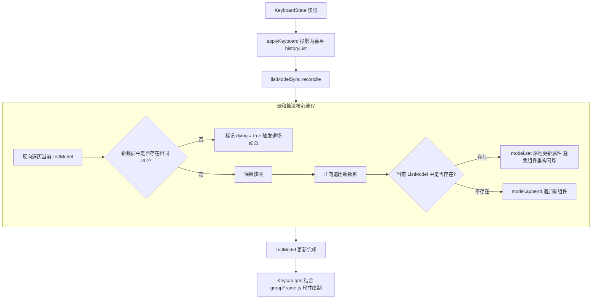
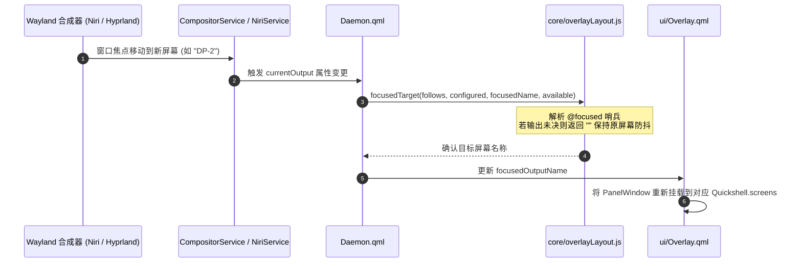
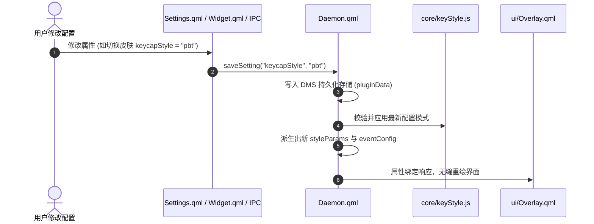

# Runtime & Business Flows

## 1. Overview

本文档详细描述 Keystrokes 在运行生命周期内的核心业务逻辑、事件流转机制、状态机跃迁、动态调和以及异常容灾流程。

---

## 2. Application Startup & Initialization Flow

DMS 加载插件时，`Daemon.qml` 作为单例启动并初始化运行时上下文。



### 关键步骤与容灾降级
1. **配置自愈与版本迁移**：`keyStyle.settings()` 检查存储中的废弃键名（如历史遗留的 `showNormalKeys`、`showMouseClicks`），将其安全平移到新键结构并落盘。
2. **工具探测与降级**：
   - 优先检查系统 PATH 中是否存在 `libinput`；
   - 若缺失，且用户指定了单设备模式，尝试回退使用 `evtest`；
   - 若均不可用或没有 `/dev/input/*` 读权限，设置 `inputBroken = true`，在 Settings 与 Widget 中向用户呈现告警，避免后台死锁崩溃。

---

## 3. Main Business Flow: Keystroke to Screen

这是系统的核心主流水线：从物理按键按下，到最终屏幕像素渲染呈现。



### 关键处理函数与组件
- **分词与去重**：`core/inputParse.js` 处理每一行文本。若遇到 Linux 内核自动重发标记（autorepeat，`value 2`），直接返回 `null` 剔除，由状态机自主管控连击。
- **标签映射幂等性**：`Daemon.displayKeyLabel` 对已是显示标签的输入保证幂等（`dk("Ctrl") === "Ctrl"`），避免键盘、鼠标、IPC 路径分叉。
- **不可变状态生成**：`Events.press()` 计算出的 `KeyboardState` 每次均为不可变引用，确保多端绑定安全。

---

## 4. Key Filtering & Hotkey Arbitration Flow

门禁系统控制“什么按键允许在屏幕上呈现”，核心判定函数为 `core/events.js` 中的 `isAllowedSequence()`。

```mermaid
flowchart TD
    Start([按键事件到达: label]) --> CheckFilter{当前过滤模式 eventFilter}
    
    CheckFilter -->|none (Off)| Allow[放行: 进入屏幕显示]
    CheckFilter -->|modifiers (Hotkeys)| CheckMod{起手键 labels[0] 是否属于内置修饰键?}
    CheckFilter -->|custom (Custom)| CheckCustom{起手键 labels[0] 是否属于 allowedKeys?}

    CheckMod -->|是 (Ctrl/Shift/Alt/Super/Fn)| Allow
    CheckMod -->|否 (普通字符/未在首位)| Reject[门禁拦截: 绝不上屏]

    CheckCustom -->|是| Allow
    CheckCustom -->|否| Reject

    Allow --> AddShown[加入 shownKeys 并更新 groups 按键行]
    Reject --> AddHeldOnly[仅加入 heldKeys, 不加入 shownKeys, 不建行]
```

### 核心过滤规则
1. **起手键决定论 (Leading Key Dictates)**：
   - 判定标准仅检测当前手势的最先按下键 `labels[0]`：
     ```javascript
     return set.includes(labels[0]);
     ```
   - 用户必须**先按修饰键**：`Ctrl + C` 会完整显示，但先按 `C` 再按 `Ctrl` 则整组被拒。
2. **`heldKeys` 与 `shownKeys` 双集合机制**：
   - **`heldKeys`（物理按住）**：记录物理上手指未松开的所有键。即使被门禁拦截的普通键也会被记录。只要它未松开，它就是起手键，能持续挡住后续按键。
   - **`shownKeys`（视觉呈现）**：仅记录被门禁放行的按键。被拦截的按键**绝不进入 `shownKeys`**，因此旧行中同名的键帽绝不会凭空触发按压动效。
3. **鼠标与滚轮过闸**：
   - 裸鼠标点击、纯滚轮滑动在 `Hotkeys` 模式下因起手键非修饰键而被静默丢弃。
   - `Ctrl + 鼠标左键`、`Ctrl + 滚轮` 中，由于 `Ctrl` 处于物理按住状态并占据起手位置，鼠标事件得以作为组合成员正常显示。

---

## 5. State Machine & Chord Resolution Flow

`core/events.js` 内部维持高内聚的状态转换逻辑，处理多键组合、连击计数与孤立按键的裁决。

```mermaid
stateDiagram-v2
    [*] --> Idle: 初始状态 (initialState)

    Idle --> LoneModifier: 单独按下修饰键 (如 Ctrl)
    note right of LoneModifier
      物理上无法区分是单独连击
      还是组合键的开头
      因此置入 pending 状态挂起
    end note

    LoneModifier --> LoneModifier: 再次按下同个修饰键 (Resumed)
    note right of LoneModifier: 确认连击: count + 1

    LoneModifier --> ChordActive: 按下协同键 (Resolves: 如按下 C)
    note right of ChordActive
      修饰键保留连击数
      协同键作为新成员加入
      构成完整组合键
    end note

    LoneModifier --> RetypedChord: 按下上一组合键的历史成员 (Retyped)
    note right of RetypedChord: 撤销暂定行，整行成员 count 各 +1

    LoneModifier --> Idle: 超过超时时间淡出 (未等到后续按键)

    Idle --> NormalKeyPress: 按下普通按键 (全显示模式)
    NormalKeyPress --> NormalKeyPress: 重复按下同一个键 (原地 count + 1)
```

### 关键语义与边界处理
1. **计数永不回退 (Monotonic Counts)**：
   - 按下 4 次 `Ctrl`，随后按下 `Ctrl + C`，最终显示为 `Ctrl×5 + C×1`。
   - 和弦形成绝不重置修饰键计数，杜绝视觉上的“计数莫名归零”。
2. **暂定修饰键（Pending Modifier）延期决议**：
   - 孤立修饰键按下时，状态机先行画出键帽（计数值 `settled + 1`），但打上 `pending` 标记。
   - **松开修饰键并不能结算该悬念**：因为松开单键与快速敲击组合键的第一个键在松开瞬间完全同构。该悬念必须存活至下一个按键到达或彻底超时淡出。
3. **替换模式 (Replace) 与历史模式 (History)**：
   - **替换模式 (`showEventHistory = false`)**：松开的按键在下一个按键加入组合时立刻下屏，始终保持当前最新手势。
   - **历史模式 (`showEventHistory = true`)**：按键松开后保留在它已完成的历史行中，新按键另起新行。单键输入时每按一次均开辟独立行，受 `maxHistory` 深度限制。

---

## 6. Key Lifecycle & Expiry Flow

按键的生命周期由按下时刻、松开时刻以及统一的消逝定时器共同管理。

```text
按下 (press) ────► 按住 (held) ────► 松开 (release) ────► fadeTimeout ────► 退场动画 (250ms) ────► 实体销毁
                    │                                    │                  │                      │
                    └─ 计数持续累加                       └─ 键帽留存，计数有效 └─ 标记 dying: true     └─ 计数归零，彻底下屏
```



### 核心生命周期规则
- **松开开始计时**：`release()` 将键的 `lastPressedAt` 刷为当前时刻。按住不放时永不超时。
- **计数与显示寿命完全对齐**：**键帽在屏 = 计数有效；键帽消失 = 手势结束 = 计数归零**。若修饰键已完全淡出，下次再按必须从 1 开始重新计数。
- **特殊交互停留时长**：
  - 鼠标滚轮（Wheel）：无松开信号，滚动静止 300ms 后视为松开，继而进入 `fadeTimeout`。
  - 鼠标拖拽（Drag）：按住移动超过 `dragThreshold`（默认 50px）后，原按键键帽被替换为 `Drag`。

---

## 7. View Projection & QML Reconciliation Flow

将领域状态树同步到 QML 场景图的核心机制。



### 几何计算与无裁剪原则
1. **绝不使用 `clip: true`**：
   - 裁剪会导致按压时的阴影和右上角按键计数徽章被切掉。
2. **几何向外膨胀**：
   - `core/groupFrame.js` 统一根据当前配置计算包络外框：
     $$\text{Badge Outset} = \frac{\text{Badge Diameter}}{4} = \frac{0.75\text{em}}{4}$$
     $$\text{Corner Inset} = r \times (1 - \frac{1}{\sqrt{2}})$$
     $$\text{Panel Margin} = \max(\text{Padding}, \text{Corner Inset})$$
   - 面板由背景圆角矩形和内容 Row 组成平级兄弟节点，背景矩形尺寸由 `groupFrame.js` 计算，天然包容全部外挑部分。

---

## 8. Multi-Monitor & Follow-Focus Flow



- **焦点未决防抖机制**：工作区切换瞬间，合成器可能短暂返回空焦点。`overlayLayout.focusedTarget()` 在输出名称无法识别时返回空串（`""`），命令 Overlay 暂留当前屏幕，避免窗口瞬间跳跃回主显示器。

---

## 9. Configuration Update Flow



---

## 10. Error Handling & Fallback Flows

```text
┌─────────────────────────┐      ┌─────────────────────────┐      ┌─────────────────────────┐
│     缺少 libinput       │      │     输入流彻底失效      │      │     设置页无法连接      │
├─────────────────────────┤      ├─────────────────────────┤      ├─────────────────────────┤
│ 探测 PATH 中无 libinput │      │ 缺少工具或无 input 权限 │      │ Daemon 尚未完成注册     │
│ 且为单设备模式时:       │      │                         │      │                         │
│ 自动回退执行 evtest    │      │ 触发 inputBroken 告警   │      │ 设置页防御性读取降级    │
│ 继续提供核心功能        │      │ 并在界面引导用户加组    │      │ 设备下拉项安全兜底      │
└─────────────────────────┘      └─────────────────────────┘      └─────────────────────────┘
```

---

## 11. System Invariants

在维护与迭代该项目时，必须始终恪守以下五大系统不变量：

1. **按键身份唯一由显示标签决定**
   无论是键盘事件、鼠标事件还是 IPC 调试信号，进入状态机时必须已转换为统一的显示标签（如 `Ctrl` 而非 `KEY_LEFTCTRL`）。绝不可出现双重身份共存。
2. **按键计数严格单调递增，永不回退**
   一个按键在手势持续期间的连击次数 `count` 只能增加。任何情况下都不可在和弦建立时把修饰键计数强制重置为 1。
3. **计数寿命严格等于键帽在屏寿命**
   按键在屏幕上彻底淡出销毁的那一刻，代表该次手势完全终结，其计数与修饰键暂定状态必须完全归零。
4. **当前组合只由物理按住的键定义**
   只有物理处于按下状态的手指才能为后续按下的按键背书。已经松开但在屏幕上延期淡出的按键，不可参与后续快捷键和弦的构建。
5. **面板必须以几何外扩包容内容，严禁进行区域裁剪**
   为了保护徽章、高光与投影，分组底板严格不加 `clip`。所有外溢必须通过 `core/groupFrame.js` 纳入外扩边距计算。
